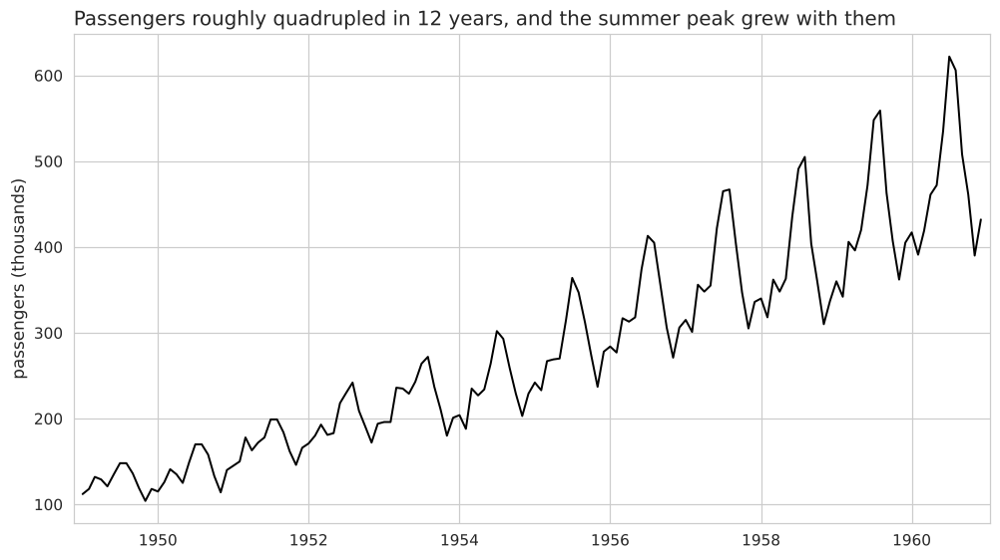
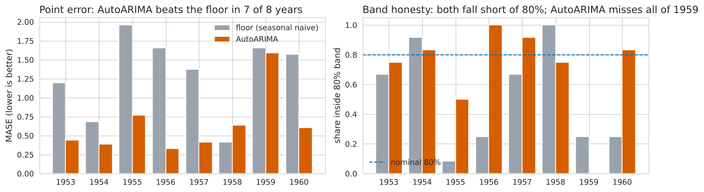
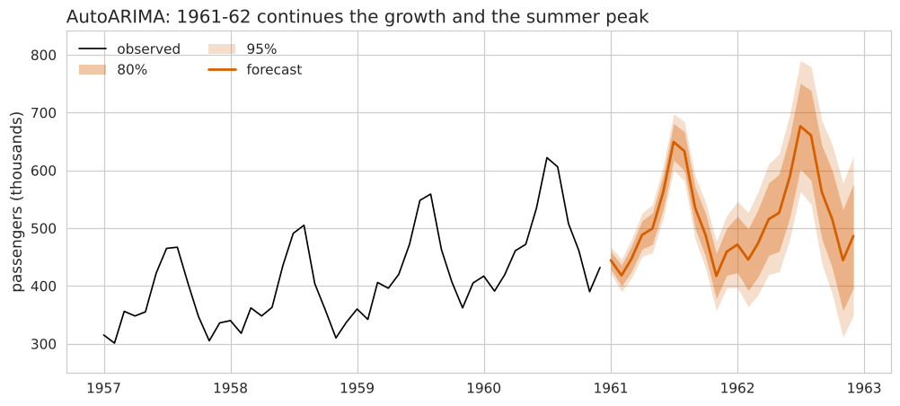
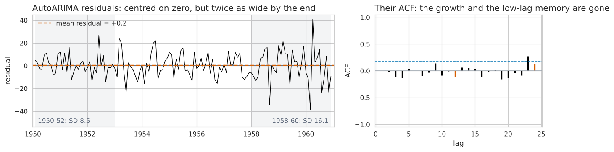

# Forecasting monthly air passengers: what to ship and how far to trust it

*Monthly international air passengers, January 1949 to December 1960.
Every number below is printed by `project.ipynb`.*

**The series in two sentences.** Air travel grew steadily, from about 127
thousand passengers a month in 1949 to about 476 thousand in 1960, and every
year has the same rhythm: a summer peak in July-August and a low in
November. As traffic grew the summer peak grew with it, so the swings are
proportional to the level, not a fixed size.

## 1. Recommendation

**Ship a seasonal ARIMA model (AutoARIMA): over eight separate test years it
cut the average forecast error roughly in half compared with simply
repeating last year (error score 0.65 vs 1.31).**

How it was tested. The benchmark - the "floor" every model must beat - is
the simplest sensible forecast: *next January = this January*. Each candidate
was then tested the way it would be used: train on everything up to the end
of a year, forecast the next 12 months, compare with what actually happened,
and repeat for eight years (1953 to 1960). No model saw the year it was
being scored on.

| model | point error (MASE, lower is better) | distribution error (scaled CRPS, lower is better) | share of months inside the 80% band (target 80%) |
|---|---|---|---|
| Repeat last year (the floor) | 1.31 | 0.062 | 51% |
| Repeat last month | 2.12 | 0.110 | 69% |
| Last value + average drift | 1.81 | 0.095 | 76% |
| AutoETS | 0.95 | 0.050 | 49% |
| AutoTheta | 0.90 | 0.046 | 59% |
| **AutoARIMA (recommended)** | **0.65** | **0.034** | **70%** |

*MASE: average error, measured against the error of repeating last year on
the training data (1.0 = as good as that). CRPS: the same idea for the whole
range of outcomes the model predicts, not just its single best guess.*

- AutoARIMA beats the floor in **7 of 8 years**. It lost in **1958**, the one
  year growth stalled, when "repeat last year" happened to be right.
- It wins on **both** the single forecast and the range: its point error and
  its distribution error are both about half the floor's.
- It is close to unbiased: on average it was 5.9 thousand passengers a month
  too low, against 34.9 too low for the floor, which misses each year's
  growth.
- The automated framework (AutoGluon) ranked the same models on **one**
  held-out year, and on that year it put AutoETS ahead of AutoARIMA by a
  margin too small to mean anything. Over eight years the order is clear.
  AutoETS chose a version with no growth term, so it under-forecasts every
  year.

## 2. The intervals: useful, but optimistic

The 80% band is the range the model says the true value will fall in four
months out of five.

- **Width.** On average the band is 13% of the forecast (the floor's is 27%).
  For the 1961-62 forecast it widens from 30 thousand passengers in month 1 to
  82 thousand in month 12 and 181 thousand in month 24.
- **Coverage.** In testing it held **70%** of months, not 80% (its 95% band
  held 84%). The misses are concentrated: in 1959, after the flat 1958, it
  forecast modest growth and traffic jumped back - it missed **all 12 months**
  of that year. In the other seven years it averaged about 80%.
- **Verdict.** Honest in ordinary years, too narrow after a shock. The
  floor's band is worse: 51% coverage, and every miss was above the band,
  because it never expects growth. Plan with AutoARIMA's band, but treat its
  80% band as closer to a 70% band, and widen it after an unusual year.

The 1961 forecast is 6.0 million passengers for the year, against 5.7
million in 1960 (+6%), with the usual summer peak and November low.

## 3. What the models missed

- **The floor** misses the growth: its errors average +31.8 thousand a month,
  and an error in one month tends to persist into the next ones. That is the
  pattern a model with a growth term and short-term memory removes - and
  AutoARIMA does exactly that.
- **AutoARIMA** leaves no clear pattern in its errors: they average zero and
  one month's error does not predict the next (one marginal blip at a
  23-month lag, not worth chasing).
- **What it still misses** is the *size* of its errors: they double over the
  period (spread 8.5 thousand in 1950-52, 16.1 in 1958-60) because the model
  works in fixed-size passengers while the real swings grow in proportion to
  traffic. That is why its band is too narrow in the busy late years.

## 4. One change

**Fit the model on the logarithm of passengers** (equivalently, model
percentage changes instead of raw counts), and re-run the same eight-year
test. Because the seasonal swings and the errors grow in proportion to
traffic, working in percentages should make the errors a steady size: I
expect the band to become narrower in the early, low-traffic years and wider
in the recent ones, bringing 80% coverage up toward 80% without losing the
point-forecast accuracy. Success is measured on the same table: coverage near
80% and CRPS at or below 0.034.
